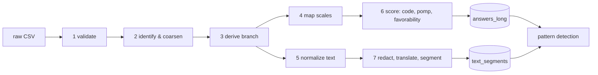

# 05 — Standardization Specification

How a raw Google Forms export becomes a clean, comparable, privacy-safe dataset.
Every rule here answers an issue in [04-data-quality](04-data-quality.md).

## Principles

1. **Position is the contract.** Columns are mapped by index via the [data dictionary](03-data-dictionary.md).
2. **Strict mapping, loud failure.** An unknown scale label, an unexpected column count or a
   changed header fingerprint stops the pipeline. Silent coercion hides form changes.
3. **Never overwrite raw values.** Each stage writes a new table; raw text stays in the restricted zone.
4. **Missing ≠ "no problem" ≠ "can't judge".** Every cell gets an explicit response status.
5. **Config, not constants.** Label maps, thresholds and patterns live in YAML under `config/`
   so they can change without touching code.

## Pipeline stages



| # | Stage | Input → Output | Key rules |
|---|---|---|---|
| 1 | Validate | CSV → in-memory frame | 86 columns; header fingerprint matches `survey_schema.yaml`; UTF-8; real CSV parser for multi-line cells. |
| 2 | Identify & coarsen | → `respondents` | Assign pseudonymous `response_id` (keyed hash, [D-011](../DECISIONS.md)). Parse timestamp with locale config (`ÖÖ`=AM, `ÖS`=PM, `GMT+3`) → owner-local month = `wave_id` (explicit `--wave` required if submissions span months, [D-015](../DECISIONS.md)). Flag later duplicate submissions. **Drop the timestamp** and **sort every output by `response_id`** so row order reveals nothing ([D-014](../DECISIONS.md)). |
| 3 | Derive branch | → `respondents.branch` | Branch = block (T/S/O) with ≥ 1 non-empty cell; 0 → `none`; >1 → `multiple` + `qflag_multiple_branches`. Blank cells in the own branch → `EMPTY`, in other branches → `NOT_ROUTED`. |
| 4 | Map scales | → `answers_long` | Exact-match lookup in the [scale catalogue](#scale-catalogue) after whitespace normalization. N/A options → status `NO_BASIS`. Unknown label → error. |
| 5 | Normalize text | → `text_answers` | Unicode NFC; apostrophes `´ ’` → `'`; collapse whitespace; classify [response status](#response-status-taxonomy). |
| 6 | Score | `answers_long` += `code`, `value`, `pomp`, `favorability` | See [Scoring](#scoring). |
| 7 | Redact, approve, code | → `llm_manifest.csv` → `review_segments.csv` → `text_segments` | Local redaction (regex + spaCy NER EN/DE + allowlist, `config/redaction.yaml`) → analyst approves each row in the send manifest → one LLM call per approved answer translates, segments and codes it ([D-016](../DECISIONS.md)) → human review → import. |

## Scale catalogue

`code` is the ordinal position (1 = lowest). Labels marked *(expected)* were not observed in
the pilot export and must be confirmed against the form before go-live.

| scale_id | code 1 | code 2 | code 3 | code 4 | code 5 | N/A option → `NO_BASIS` | pol |
|---|---|---|---|---|---|---|---|
| `QUALITY5` | Very poor *(expected)* | Poor *(expected)* | Neither poor nor good | Good | Very good | Not enough experience to judge | + |
| `SAT5` | Very dissatisfied | Dissatisfied | Neither satisfied nor dissatisfied | Satisfied | Very satisfied | – | + |
| `CLARITY5` | Very unclear | Unclear *(expected)* | *(middle label unknown)* | Clear | Very clear | – | + |
| `EASE5` | Very difficult *(expected)* | Difficult *(expected)* | *(middle label unknown)* | Easy | Very easy | – | + |
| `AGREE5_LABELED` | Strongly disagree | Disagree *(expected)* | Neither agree nor disagree | Agree | Strongly agree | Unable to judge | + |
| `AGREE5_NUMERIC` | `1` | `2` | `3` | `4` | `5` | – | + *(anchors to confirm)* |
| `IMPORTANCE5` | Not at all important *(expected)* | Slightly important *(expected)* | Moderately important | Very important | Extremely important | – | + |
| `PROB5` | 0 % *(expected)* | 25 % — Unlikely | 50 % — Equally likely and unlikely | 75 % — Likely | 100 % *(expected)* | – | + |
| `DESIRABILITY5` | Very undesirable *(expected)* | Undesirable *(expected)* | Neither desirable nor undesirable | Desirable *(expected)* | Very desirable | – | + |
| `EFFECTIVE5` | Not at all effectively *(expected)* | … | … | … | Very effectively | – | + |
| `COMPLETE5` | Very incomplete *(expected)* | … | … | … | Very complete | – | + |
| `EXTENT5` | Not at all *(expected)* | … | Moderately | … | *(expected)* | – | **−** |
| `DIFFICULTY5` | Not difficult at all | … | … | … | *(expected)* | – | **−** |

Numeric scales: `NUM0_10` (Q22, codes 0–10), `NUM1_5` (Q23, codes 1–5). Parse as int; out of range → error.

The lookup key is the **full bilingual label** exactly as exported (e.g. `Agree / Stimme zu`),
after whitespace normalization. Excerpt of [`config/scales.yaml`](../config/scales.yaml):

```yaml
PROB5:
  kind: ordinal
  min: 1
  max: 5
  labels:                       # observed in a real export — trusted
    "25% — Unlikely / Unwahrscheinlich": 2
    "50% — Equally likely and unlikely / Ebenso wahrscheinlich wie unwahrscheinlich": 3
    "75% — Likely / Wahrscheinlich": 4
  expected_labels:              # guessed wording — maps, but flagged label_unverified + warning
    "0% — Very unlikely / Sehr unwahrscheinlich": 1
    "100% — Very likely / Sehr wahrscheinlich": 5
  values: {1: 0.0, 2: 0.25, 3: 0.5, 4: 0.75, 5: 1.0}   # code -> metric value
```

Polarity is defined per column in `config/survey_schema.yaml`, not per scale. Any label that is in
neither list stops the pipeline with `UnknownLabelError` ([DECISIONS D-012](../DECISIONS.md)).

## Scoring

| Field | Definition |
|---|---|
| `code` | Ordinal integer from the catalogue. |
| `value` | Scale-specific metric value where meaningful: probability for `PROB5` (0–1), valence for `DESIRABILITY5` (−1…+1), else = `code`. |
| `pomp` | Percent of maximum possible: `(code − min) / (max − min) × 100`; if polarity is `−`: `100 − pomp`. Puts every item on 0–100, **higher = healthier**. |
| `favorability` | `favorable` / `neutral` / `unfavorable` bucket. 5-point: 4–5 / 3 / 1–2 (after polarity). 0–10: ≥ 7 / 5–6 / ≤ 4. Cut-offs in `config/scoring.yaml`. |

`pomp` enables cross-scale composites; `favorability` is what goes in human-facing reports
("4 of 9 respondents unfavorable"), because means are misleading at small N.

## Response status taxonomy

| Status | Meaning | Typical patterns (EN / DE) | In denominator? |
|---|---|---|---|
| `SUBSTANTIVE` | A real answer | – | yes |
| `NO_ISSUE` | Explicit "nothing wrong / no change needed" — **a positive signal** | no obstacle, no change (is) necessary, responsibilities are clear / kein Hindernis, keine Änderung nötig | yes |
| `NO_BASIS` | Cannot judge; question not applicable to the person | not enough experience, unable to judge, no customer contact, not in a position to answer / kann ich nicht beurteilen, kein Kundenkontakt | no — reported separately |
| `NOTHING_TO_ADD` | Has a basis but no idea / nothing comes to mind | don't know, couldn't think of one, nothing comes to mind / weiß nicht, mir fällt nichts ein | no — **except Q14/Q15**, where "nothing" is itself meaningful (no pride / no enjoyment) and is reported as a share |
| `PLACEHOLDER` | Token answer without content | `-`, `.`, `n/a`, `x` | no |
| `EMPTY` | Blank in a block the respondent was routed to | – | no |
| `NOT_ROUTED` | Blank in a branch block the respondent was not routed to | – | excluded entirely |

Classification order: exact/regex patterns from `config/nonanswer_patterns.yaml` → LLM
classifier for anything ambiguous → human review for low-confidence cases.

## Text processing

| Step | Rule |
|---|---|
| Keep raw | `text_raw` stays in `data/interim/` (restricted). Never sent anywhere. |
| Normalize | NFC, apostrophe unification, whitespace collapse → `text_norm`. |
| Language | `en` / `de` / `mixed` (mixed = embedded foreign phrase, e.g. a quoted German term in an English answer). |
| Redact | Person names, e-mail addresses, phone numbers, customer/company names, unique role descriptors ("the only X here") → placeholders `[PERSON]`, `[CUSTOMER]`, `[ROLE]`. Runs **before** translation or LLM coding. |
| Translate | DE → EN into `text_en`; original kept. A project glossary (`config/glossary.yaml`) preserves internal jargon with a gloss, e.g. `"bekanntes Thema" → "known issue (internal jargon)"`. |
| Segment | Split multi-idea answers into idea units (one claim / complaint / suggestion each). |
| Spelling | Correct only in `text_en`; never derive features from spelling or style. |

## Output tables

All tables are Parquet files under `data/processed/` (respondent-level → restricted, gitignored).

**`respondents`** — one row per response

| Column | Type | Notes |
|---|---|---|
| `response_id` | uuid | random |
| `wave_id` | str | e.g. `2026-10` |
| `branch` | enum | technical / sales / back_office / none / multiple |
| `core_completion` | float | 0–1 |
| `qflag_*` | bool | see [04 › Quality flags](04-data-quality.md#quality-flags-summary) |

**`answers_long`** — one row per response × closed item

| Column | Type |
|---|---|
| `response_id`, `wave_id`, `var_id`, `q_no`, `block`, `scale_id`, `polarity` | keys / metadata |
| `code`, `value`, `pomp` | numeric |
| `favorability`, `status` | enum |

**`text_segments`** — one row per idea unit

| Column | Type |
|---|---|
| `segment_id`, `response_id`, `var_id`, `seq` | keys |
| `status`, `lang` | enum |
| `text_en_redacted` | str |
| `theme`, `subtheme`, `locus`, `valence`, `intensity`, `sarcasm`, `actionable`, `suggestion` | coding fields, see [07](07-text-codebook.md) |
| `coder`, `confidence`, `review_status` | provenance |

## Validation checklist (automated)

- [ ] Column count = 86 and header fingerprint matches config
- [ ] Every non-empty scale cell maps to a known label
- [ ] Numeric cells within range
- [ ] Q16 and Q17 each have exactly 14 items with matching factor keys
- [ ] Each response has at most one branch (`multiple` flagged)
- [ ] No timestamp column survives into `data/processed/`
- [ ] No text field in `data/processed/` matches the PII detectors
- [ ] Identical duplicate rows flagged (double submission)
