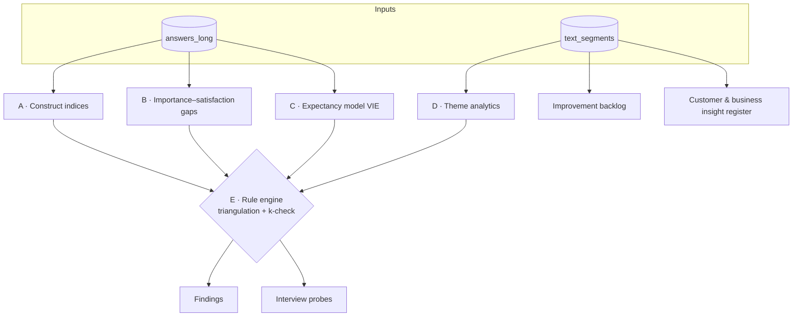

# 06 — Pattern Detection Model

How standardized answers become **findings**: recurring, triangulated patterns at group level —
especially leadership/management friction and efficiency losses.



## Small-N policy

The pilot has N = 3. Methods unlock as N grows. Thresholds live in `config/analysis.yaml`.

| Condition | Allowed |
|---|---|
| any group with n < k (`privacy.k`, default **5**) | Nothing reported for that group. Analyst-internal QA only. |
| n ≥ k | Counts and favorability shares ("4 of 9 unfavorable"), theme shares, rule evaluation |
| n ≥ 10 | Means with confidence intervals, index distributions |
| n ≥ 30 | Correlations, derived importance / key-driver analysis, internal-consistency checks (Cronbach's α per index) |
| comparing groups | every compared group ≥ k **and** complementary suppression (see [08](08-privacy-and-ethics.md#complementary-suppression)) |

## Scoring rules

- A respondent's index is computed only if ≥ `analysis.min_item_share` (default 0.5) of its
  items have status `SUBSTANTIVE`; otherwise it is missing.
- Index = weighted mean of item `pomp` (equal weights by default; weights in `config/constructs.yaml`).
- Group index = mean of respondent indices; always shown together with n and favorability shares.
- Branch-only items (T/S/O blocks) contribute only for respondents of that branch.
- Each item has one **primary** construct ([data dictionary](03-data-dictionary.md)); Q19–Q21 additionally feed the VIE model.

## A. Construct indices

All on 0–100, **higher = healthier**.

| Index | Items | Comment |
|---|---|---|
| `LEAD_DIRECT` | q17_sat_rel_supervisor, q20_instrumentality | Direct-supervisor specific |
| `LEAD_ORG` | q18f_supported_by_leadership, q13b_change_informed_timely, q23_company_support, q17_sat_job_security | q18f is double-barreled (supervisor *or* management) |
| `RECOGNITION` | q17_sat_recognition, q18b, q18c, q18d, q18e | Appreciation, timeliness, fairness, transparency |
| `VOICE_CONFLICT` | q18a, q18i, q17_sat_idea_contribution | Psychological safety & conflict handling |
| `ROLE_CLARITY` | q09_role_clarity_own, q18g_priorities_clear | |
| `WORKLOAD` | q17_sat_workload, q17_sat_work_life_balance, q18h_time_sufficient | |
| `INFO_FLOW` | q07, q13a, q17_sat_info_access, tec4\*, bo2\* | |
| `XFUNC` | q05, q10, q11, tec2\*, bo4\*, sal3\* (reversed) | Cross-functional cooperation |
| `PEER` | q04, q17_sat_rel_colleagues | |
| `GROWTH_MEANING` | q17_sat_autonomy, _development, _interesting_tasks, _meaningful_work | |
| `RESOURCES` | q17_sat_tools_resources | single item |
| `COMPENSATION` | q17_sat_pay | single item |
| `ENGAGEMENT` *(outcome)* | q18j_recommend_employer, q22_motivation_2w | Outcome, not a driver — used to check which drivers matter |

\* branch items

### Composite indices (higher = more friction)

| Composite | Definition | Answers the question |
|---|---|---|
| **Leadership Friction Index (LFI)** | `100 − wmean(LEAD_DIRECT, LEAD_ORG, RECOGNITION, VOICE_CONFLICT, ROLE_CLARITY)` | "How much friction comes from how people are led, recognized and given direction?" |
| **Operational Friction Index (OFI)** | `100 − wmean(INFO_FLOW, XFUNC, RESOURCES, WORKLOAD)` | "How much effort is lost to information gaps, handovers, tools and capacity?" |

Comparing LFI vs OFI per group is the first triage: *is this a people-leadership problem or a
process problem?* Weights are configurable and should be reviewed with the analyst's domain
knowledge before the first report.

## B. Importance–satisfaction gap analysis

For each of the 14 paired factors (Q16 × Q17):

| Metric | Definition |
|---|---|
| `gap_<factor>` (respondent) | `imp_code − sat_code`, range −4…+4. Positive = under-served need. |
| mean importance / satisfaction (group) | mean of codes |
| critical share | share of respondents with `imp ≥ 4` **and** `sat ≤ 2` |
| priority score | `mean_imp × max(0, mean_imp − mean_sat)` |

Quadrants (cut-offs in config, defaults: importance 4.0, satisfaction 3.0):

| | satisfaction < 3 | satisfaction ≥ 3 |
|---|---|---|
| **importance ≥ 4** | **Fix first** | Keep up |
| **importance < 4** | Monitor | Possible over-investment |

**Ceiling effect.** People rate almost everything "very" or "extremely" important (true in the
pilot). Also compute *relative* importance: `imp_code − respondent's mean importance`, so each
person's priorities stand out against their own baseline. From N ≥ 30, add *derived* importance
(correlation of each satisfaction item with `ENGAGEMENT`), which is less inflated than stated importance.

Report hygiene factors (pay, job security, workload, work-life balance, tools, information,
relationships) separately from motivators (recognition, development, interesting & meaningful work,
autonomy, idea contribution) — they call for different interventions.

## C. Expectancy model (VIE)

Q19–Q21 implement Vroom's expectancy theory:

| Component | Item | Value range | Question it answers |
|---|---|---|---|
| E — Expectancy | q19 | 0–1 | Can my effort, under current conditions, achieve the expected performance? |
| I — Instrumentality | q20 | 0–1 | If I perform, will my **direct supervisor** recognize it? |
| V — Valence | q21 | −1…+1 | Do I value my supervisor's recognition? |

`vie_mf = E × I × V` (motivational force, −1…+1). Validate against `q22_motivation_2w` once N ≥ 30.

**Weakest-link diagnosis** — for each respondent, the component with the lowest pomp is the
bottleneck. The group distribution of bottlenecks points to the type of intervention:

| Bottleneck | Interpretation | Look next at |
|---|---|---|
| **E** | Working conditions prevent success — a *system* problem | WORKLOAD, RESOURCES, ROLE_CLARITY, obstacle themes |
| **I** | Performance does not reliably lead to recognition — a *leadership practice* problem | LEAD_DIRECT, RECOGNITION, q18c |
| **V** | Supervisor recognition carries little value — preference **or** relationship/trust erosion | If `q16_imp_recognition ≥ 4` but V ≤ 0 → "recognition matters, but not from this source" → relationship signal (LEAD_DIRECT, trust themes) |

## D. Theme analytics (free text)

Free text is coded per idea unit using the [text codebook](07-text-codebook.md). Analytics:

| Metric | Definition | Why |
|---|---|---|
| theme share | share of **respondents** with ≥ 1 segment of the theme | One verbose respondent must not dominate |
| locus mix | distribution of `locus` within a theme | Separates "management" from "process" causes |
| valence | share negative / positive | |
| co-occurrence | theme pairs within the same respondent | e.g. responsibility diffusion + follow-up burden |
| scale linkage | mean index of respondents with vs. without the theme (n ≥ 10 each) | Does the theme coincide with lower scores? |

## E. Rule engine (triangulated patterns)

A **finding** is produced only when a rule's conditions hold for a group with n ≥ k and enough
independent signals agree. Rules are declarative (`config/rules.yaml`) so the analyst can tune
them without code changes.

```yaml
# config/rules.yaml (planned) — example
- id: L01
  name: Responsibility diffusion / decision avoidance
  family: leadership
  signals:
    - type: text
      themes: [LEAD.RESPONSIBILITY_DIFFUSION, LEAD.DECISION_AVOIDANCE]
      min_respondent_share: 0.20
    - type: index
      index: ROLE_CLARITY
      op: "<"
      value: 60
    - type: item
      item: q18a_disagreement_constructive
      unfavorable_share_gte: 0.30
  min_signals: 2              # triangulation: at least 2 of the 3 must hold
  interview_probe: >
    When a decision has unpleasant consequences, how does it get made — and who ends up owning it?
  candidate_actions:
    - Decision owner + deadline for recurring decision types (RACI)
    - Lightweight decision log visible to affected teams
```

### Rule catalogue (v0 — to be calibrated once N ≥ k)

**Leadership & management (L)**

| ID | Pattern | Scale signals | Text signals |
|---|---|---|---|
| L01 | Responsibility diffusion / decision avoidance | ROLE_CLARITY low; q18a unfavorable | `LEAD.RESPONSIBILITY_DIFFUSION`, `LEAD.DECISION_AVOIDANCE` |
| L02 | Recognition breakdown | RECOGNITION low; q20 ≤ 50 %; q18c unfavorable | `CULT.RECOGNITION_LACK` |
| L03 | Direct-supervisor relationship strain | LEAD_DIRECT low; V ≤ 0 while recognition importance ≥ 4 | any negative segment with locus `direct_supervisor` |
| L04 | Strategic churn / priority instability | q09 low; q13b unfavorable | `STRAT.DIRECTION_CHANGES`, `STRAT.SHORT_TERMISM`, `ROLE.SHIFTING_RESPONSIBILITIES` |
| L05 | Trust deficit toward management | q18f unfavorable; q23 ≤ 2 | `CULT.TRUST_DEFICIT` with locus `management` |
| L06 | Low psychological safety | q18i and q18a unfavorable | `CULT.FEAR_OF_SPEAKING` |
| L07 | Meeting overload / slow decision cycles | q18h unfavorable | `PROC.MEETING_OVERLOAD`, `LEAD.DECISION_LATENCY` |
| L08 | Opaque or unfair reward criteria | q18d, q18e unfavorable; pay gap | `REW.PAY`, `REW.CRITERIA_OPAQUE` |

**Operational efficiency (O)**

| ID | Pattern | Scale signals | Text signals |
|---|---|---|---|
| O01 | Information chase / follow-up burden | INFO_FLOW low | `INFO.FOLLOW_UP_BURDEN`, `INFO.MISSING_ANSWERS` |
| O02 | Handover gaps | tec4 / bo2 unfavorable | `INFO.HANDOVER_MISSING` |
| O03 | Department-dependent cooperation quality | q05 neutral/unfavorable while q11 favorable (reachable ≠ cooperative) | `XFUNC.VARIES_BY_DEPT` |
| O04 | Single-person roles / no backup (bus factor) | q04 `NO_BASIS` share | `ORG.SOLO_ROLE` — *aggregate share only* |
| O05 | Capacity bottleneck blocks improvement | WORKLOAD low; sal3 unfavorable | `CAP.NO_CAPACITY` |
| O06 | Avoidable rework from poor upstream quality | – | `PROC.REWORK_INHERITED` |
| O07 | Tool / resource gap | RESOURCES low; tools gap ≥ 2 | `TOOL.*` |

**Wellbeing & engagement (W)**

| ID | Pattern | Signals |
|---|---|---|
| W01 | Disengagement cluster | share of respondents with q18j ≤ 2 **and** q22 ≤ 4 **and** q23 ≤ 2 — reported as a share only, never as a list |
| W02 | Work-life balance strain | share with `gap_work_life_balance ≥ 2`; q18h unfavorable |
| W03 | Meaning / growth deficit | GROWTH_MEANING low; gaps on meaningful work or autonomy |
| W04 | Pay or security concern | COMPENSATION low; pay / job-security gaps |

**Business & customer (B)** — text-driven, feed the insight register

| ID | Pattern | Text signals |
|---|---|---|
| B01 | Portfolio gap — deals lost to broader providers | `BIZ.PORTFOLIO_GAP` |
| B02 | Customers unaware of the offering → cross-sell potential | `BIZ.OFFER_AWARENESS` |
| B03 | Customer needs not reaching sales | tec2 unfavorable; `XFUNC.NEEDS_TO_SALES` |
| B04 | Door-opener services | `BIZ.ENTRY_SERVICE` |
| B05 | Customer budget constraints | `CUST.BUDGET` |

### Confidence

| Level | Requirement | Use |
|---|---|---|
| **High** | Scale **and** text signals agree; n ≥ max(2k, 10) | Report as finding |
| **Medium** | ≥ 2 signals of one type, or scale + text with n between k and 2k | Report as finding, flagged "needs confirmation" |
| **Low** | One signal, or a theme from a single respondent | **Not reported.** Becomes an interview probe / watch-list item only |

### Severity

`severity = share_affected × intensity × outcome_linkage`, bucketed 1–3 with cut-offs in config.
`outcome_linkage` > 1 when affected respondents also show lower `ENGAGEMENT` (only from n ≥ 10 per side).

## From organization level to team level

The current export has no team variable, so leadership findings are **organization-wide or
branch-level** at best. That is enough to tell management *that* — and *what kind of* —
leadership friction exists. Pinpointing it to a specific team requires a team variable in a
future wave. If that is added:

- the same rules run per team, only for teams with n ≥ k;
- respondents must be told **in the survey introduction** that results are aggregated per team
  and that teams below k are never reported separately;
- the output is aggregated upward feedback for that team's leadership — input for a
  development conversation, never a stand-alone basis for personnel decisions.

## Outputs

| Output | Content | Audience |
|---|---|---|
| `findings` | Fired rules: group, n, signals met (aggregate evidence), confidence, severity, probe, candidate actions | Management (after review) |
| `org_health_overview` | Indices, LFI/OFI, gap quadrant matrix, VIE bottleneck distribution | Management |
| `improvement_backlog` | Deduplicated suggestions (Q3 first steps, Q6, Q8, Q18.1, Q24, T7, S7, O7) with supporter counts, theme, locus | Management, process owners |
| `customer_insight_register` | Coded Q1, Q2, Q3, T1, S1, S2, S6, O6 | Sales, delivery |
| `interview_guide` | Probes from fired rules + low-confidence watch list | Analyst (interviews) |

## Explicit non-goals

- No per-person scores, rankings, risk lists or "flight-risk" names.
- No attribution of a finding to a named person; no inference of who wrote what.
- No finding from a single respondent's text, however striking.
- No automatic action — every finding goes through human review before anyone outside the analysis sees it.
