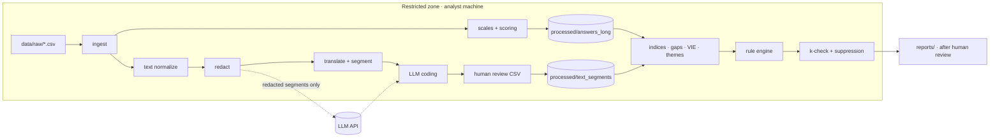

# 09 — Architecture & Implementation Plan

Status: **Phases 1–2 implemented** (ingestion, standardization, redaction, LLM coding, review). Phases 3–5 are still design.
This file describes the implementation of the
specifications in [05](05-standardization.md), [06](06-pattern-detection.md) and [07](07-text-codebook.md).

## Design goals

| Goal | Consequence |
|---|---|
| Re-runnable on every new export | Deterministic, idempotent stages; outputs fully regenerated |
| Config over code | Labels, scales, constructs, rules, thresholds, k, model IDs in YAML |
| Fail loudly on form changes | Header fingerprint + strict label mapping |
| Privacy by construction | Restricted zones, redaction before external calls, k-check in the report layer |
| Small and readable | Plain Python, few dependencies, files < 400 lines |

## Stack

| Concern | Choice | Why |
|---|---|---|
| Language | Python ≥ 3.12 | Data ecosystem; available locally |
| Environment | `uv` | Fast, lockfile-based |
| DataFrames | pandas (or polars) | Small data; pandas is familiar |
| Schemas & validation | pydantic (config); explicit column tuples + tests (frames) | Typed config, frame contracts without an extra dependency |
| Storage | Parquet + DuckDB | Columnar, file-based, SQL for ad-hoc analysis, no server |
| Config | YAML | Editable by non-developers |
| Language detection | lingua (`lingua-language-detector`) | Good on short texts, EN/DE |
| PII redaction | spaCy NER (`de_core_news_md`, `en_core_web_md`) + regex | Runs locally |
| Text coding | Claude via the Anthropic Python SDK: `claude-haiku-5-5`, structured output, prompt caching ([D-017](../DECISIONS.md), [D-018](../DECISIONS.md)) | Multilingual, handles sarcasm and context better than classic sentiment models |
| Review loop | CSV round-trip (export → analyst edits → re-import) | No UI to build; works in Excel/Sheets |
| Reports | Jinja2 → Markdown / HTML | Versionable, simple |
| Tests | pytest + synthetic fixtures | Real data never in the repo |
| Lint / format | ruff | One tool |

## Repository layout

✅ = exists (Phase 1) · ○ = planned

```
hr-data-analiz/
├── README.md
├── CLAUDE.md                     # instructions for AI-assisted sessions
├── DECISIONS.md                  # decision log
├── docs/                         # this documentation
├── pyproject.toml / uv.lock      ✅
├── config/
│   ├── survey_schema.yaml        ✅ positional column map + header hashes (mirrors 03)
│   ├── scales.yaml               ✅ label → code maps, observed vs expected labels (05)
│   ├── nonanswer_patterns.yaml   ✅ response-status patterns EN/DE + residual rule (05)
│   ├── quality.yaml              ✅ quality-flag thresholds (04)
│   ├── scoring.yaml              ✅ favorability cut-offs (05)
│   ├── redaction.yaml            ✅ regex rules, spaCy models, allowlist (08)
│   ├── codebook.yaml             ✅ machine-readable codebook, synthetic examples (07)
│   ├── llm.yaml                  ✅ model, effort, fallbacks, send statuses (07)
│   ├── glossary.yaml             ○ internal jargon with glosses (05)
│   ├── constructs.yaml           ○ index definitions + weights (06)
│   ├── rules.yaml                ○ pattern rules (06)
│   ├── analysis.yaml             ○ small-N thresholds (06)
│   └── privacy.yaml              ○ k, suppression, quoting switches (08)
├── src/hrsurvey/
│   ├── config.py                 ✅ typed YAML loading + cross-validation
│   ├── errors.py · status.py     ✅ error types, response-status enum
│   ├── timestamps.py             ✅ locale-aware timestamp parsing
│   ├── ids.py                    ✅ keyed-hash response IDs, salt handling
│   ├── ingest.py                 ✅ stages 1–3: validate, identify, wave, branch
│   ├── scales.py                 ✅ stage 4: strict label mapping
│   ├── scoring.py                ✅ stage 6: pomp, favorability
│   ├── standardize.py            ✅ closed items → answers_long
│   ├── quality.py                ✅ completion + quality flags → respondents
│   ├── text_status.py            ✅ stage 5: normalization + status (contrast word / length rule)
│   ├── text_prep.py              ✅ free text → interim text_answers
│   ├── pipeline.py · cli.py      ✅ orchestration, `hrsurvey` command
│   ├── text/                     ✅ stage 7: settings, redact, manifest, coder, review,
│   │                                pipeline, commands (Phase 2)
│   ├── analysis/                 ○ indices, gaps, VIE, themes, rule engine (06)
│   ├── privacy.py                ○ k-check, complementary suppression
│   └── report.py                 ○ outputs
├── tests/
│   ├── fixtures/                 ✅ header.csv (questions only) + make_synthetic.py
│   └── test_*.py                 ✅
├── data/                         # gitignored except README
│   ├── raw/  interim/  processed/
└── reports/                      # gitignored
```

## Pipeline



CLI (Phase 1):

| Command | Does | Writes |
|---|---|---|
| `hrsurvey init-salt` | Creates `HRSURVEY_ID_SALT` in `.env` once | `.env` |
| `hrsurvey schema-check <csv>` | Column count + header hashes vs schema | – |
| `hrsurvey standardize <csv> [--wave W]` | Stages 1–4 + 6, quality flags | `data/processed/<wave>/respondents.parquet`, `answers_long.parquet` |
| `hrsurvey text-prep <csv> [--wave W]` | Stage 5 (normalize + status) | `data/interim/<wave>/text_answers.parquet` |
| `hrsurvey redact <csv>` | Local redaction → send manifest (keeps approvals for unchanged answers) | `data/interim/<wave>/llm_manifest.csv` |
| `hrsurvey code-text <csv> [--dry-run]` | Sends **approved** manifest rows to Claude (cached), merges the review file | `llm_codes.jsonl`, `review_segments.csv`, `review_stale.csv` (interim) |
| `hrsurvey review-import --wave W [--allow-pending]` | Validates reviewed codes | `data/processed/<wave>/text_segments.parquet` |

All commands accept `--config DIR`; pipeline commands also `--data-dir DIR`. Errors exit with code 2
and a message naming the offending column, label or file.

## Testing strategy

| Test type | What | Example |
|---|---|---|
| Unit | Parsers and mappers | `ÖS` timestamp → correct UTC hour; every label in `scales.yaml` maps; unknown label raises |
| Contract | Schema of each output table | exact column lists (`ANSWERS_LONG_COLUMNS`, `RESPONDENT_COLUMNS`, `TEXT_ANSWER_COLUMNS`); doc ↔ config sync test |
| Golden file | Full pipeline on a **synthetic** export with the real header | Expected indices/flags for hand-built respondents |
| Rule engine | Each rule fires / doesn't fire on crafted inputs | L01 fires only with ≥ 2 signals and n ≥ k |
| Privacy | Guarantees, not features | No timestamp column in processed; group n < k never in report; complementary suppression; redaction catches names in DE and EN |
| LLM coding | Offline with recorded responses | Coder output parses against JSON schema; κ computation |

The synthetic fixture reuses the exact header row (it contains no respondent data) and
fabricated answers in 7 profiles: one per branch, an inconsistent profile, a straight-liner, a
low-completion response and a duplicate submission — covering every response status, N/A options,
an unverified label, multi-line cells, German text and AM/PM midnight edge cases. It is generated
at test time, so it can never drift from the schema.

## Roadmap

| Phase | Deliverable | Done when |
|---|---|---|
| 0 | Documentation & data dictionary | ✅ 2026-10-15 |
| 1 | Ingestion + standardization + validation | ✅ 2026-10-15 — pilot export standardized + text statuses; 162 tests green, 96 % coverage |
| 2 | Text pipeline: redaction, translation, segmentation, LLM coding, review loop | ✅ code 2026-10-15 (218 tests, fake API, reviewed). Pilot coding waits for the API key + manifest approval |
| 3 | Indices, gaps, VIE, theme analytics, rule engine, k-suppression | Synthetic golden test produces expected findings |
| 4 | Reports: findings, overview, improvement backlog, insight register, interview guide | First report reviewed against the privacy checklist |
| 5 *(optional)* | Wave-over-wave trends; team-level analysis (needs team variable, see [06](06-pattern-detection.md#from-organization-level-to-team-level)); dashboard | Second wave collected |

Phases 1 and 2 are independent and can be built in parallel; phase 3 needs both.
